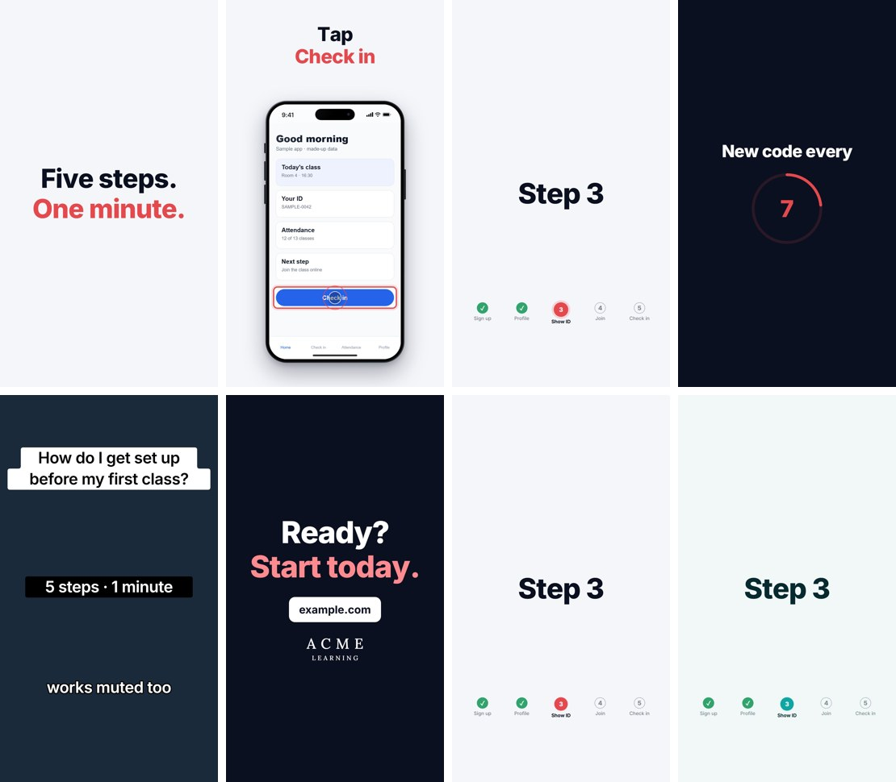

# reelkit

Motion-graphics building blocks for [Remotion](https://www.remotion.dev): the parts you rebuild for every
vertical explainer, product walkthrough or Reel.



- **Beat-based timing.** Write time in beats (1/30 s), not frames. A 60 fps render and a 96 fps "smooth
  slow" render share the same timing. Includes reading pauses (`Holds`) and stacked springs (`track`).
- **Kinetic type.** `Kinetic` letters spring into place one by one; `TextHook` draws Instagram-style text
  hooks with one continuous outline round all the lines.
- **A drawn iPhone for real screenshots.** `Phone`, `Screen` (slide and scroll pages), `Crop`, and pointers
  (`Ring`, `Touch`) you position with coordinates read straight off the screenshot.
- **Tutorial furniture.** `StepTracker` (numbered steps that tick to checks), `CountdownRing` (rotating
  codes, timers), `Caption`, `Scene` (exits on its own), `EndCard`, `Wordmark`.
- **Themes.** Components never hard-code a colour or font. Swap the theme and the same video is in another
  brand (the last two frames above are the same video).

## Install

```bash
npm install @turbo-leg/reelkit remotion react
```

## Quick start

```tsx
import { Composition } from "remotion";
import { beatsToFrames, Caption, EndCard, Kinetic, Phone, ReelkitTheme, Ring, Scene, Screen, makeTheme } from "@turbo-leg/reelkit";

const theme = makeTheme({ colors: { accent: "#0EA5A4", dark: "#062A30" } });

const Video = () => (
  <ReelkitTheme theme={theme}>
    <Scene>
      <Caption>
        <Kinetic text="Tap" size={96} />
        <Kinetic text="Check in" size={96} delay={5} color={theme.colors.accent} />
      </Caption>
      <Phone>
        <Screen src="screens/home.png" />
        {/* x, y, width, height in the screenshot's own pixels */}
        <Ring box={[60, 1480, 1050, 150]} delay={20} />
      </Phone>
    </Scene>
  </ReelkitTheme>
);

export const Root = () => (
  <Composition id="Demo" component={Video} durationInFrames={beatsToFrames(90, 60)} fps={60} width={1080} height={1920} />
);
```

Screenshots are expected 1170 px wide: a 390 × 701 viewport captured at 3×, for example with Playwright
(`deviceScaleFactor: 3`).

## Time, in beats

| | |
|---|---|
| `beatsToFrames(beats, fps)` | Whole frames for a number of beats |
| `useBeat()` | The current time in beats, inside the nearest `<Sequence>` |
| `usePop(delay, spring?)` | 0 → 1 with a little bounce, `delay` beats in |
| `track(frame, fps, [[beat, value], …])` | A value that retargets several times, smoothly, with no state |
| `warpBeat(beat, holds)`, `useHeldBeat(holds)`, `holdsLength(holds)` | Reading pauses: the picture stands still while the clock runs |
| `hash(n)` | Deterministic noise (renders must never use `Math.random()`) |

## Components

| Component | What it is |
|---|---|
| `Scene` | A full-frame scene on the paper or dark background that lifts away over its last beats |
| `Caption` | A centred caption block above the phone |
| `Kinetic` | A line whose letters spring in one after another |
| `TextHook` | Instagram-style text hook (white, black or plain), one outline for all lines |
| `Phone`, `Screen`, `Crop`, `StatusBar` | The drawn iPhone, its pages, a card cut from a screenshot |
| `Ring`, `Touch` | Point at the one thing that matters on a screen |
| `StepTracker` | Numbered steps that stay on screen through a tutorial |
| `CountdownRing` | A ring that empties and restarts every `period` seconds |
| `EndCard`, `Wordmark` | The closing card with a call to action and a brand slot |

## Themes

```ts
import { makeTheme, ReelkitTheme, useTheme } from "@turbo-leg/reelkit";

const brand = makeTheme({
  colors: { paper: "#F7F6F2", ink: "#0F2847", dark: "#0F2847", accent: "#FFD24A" },
  fonts: { sans: "Inter", serif: "Lora" },
});
```

reelkit never loads fonts itself: a theme names them and your video loads them (for example with
`@remotion/google-fonts`). Pick fonts that cover every script you write in.

## Examples

```bash
npm install
npm run studio   # every example in Remotion Studio
npm run stills   # one still per example into out/stills (what CI runs)
```

## Licence

reelkit is MIT-licensed. **Remotion itself is not MIT:** it is free for individuals and for companies of up
to three people; larger companies need a [Remotion company licence](https://www.remotion.dev/license).
Using reelkit doesn't change that.

reelkit grew out of the videos made for [Primis EduCare](https://primiseducare.com), a test-prep school in
Ulaanbaatar.
